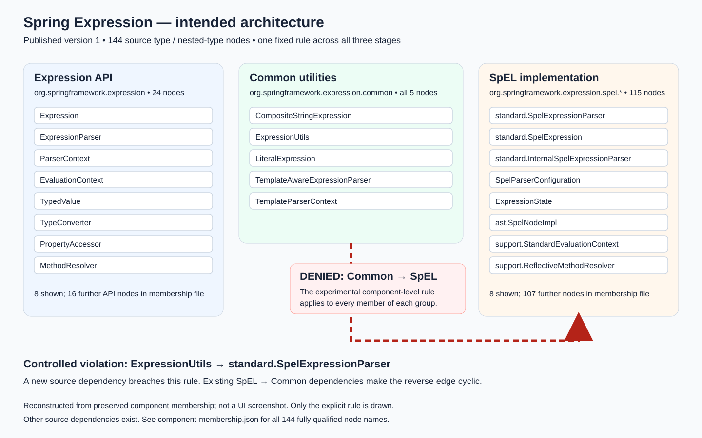
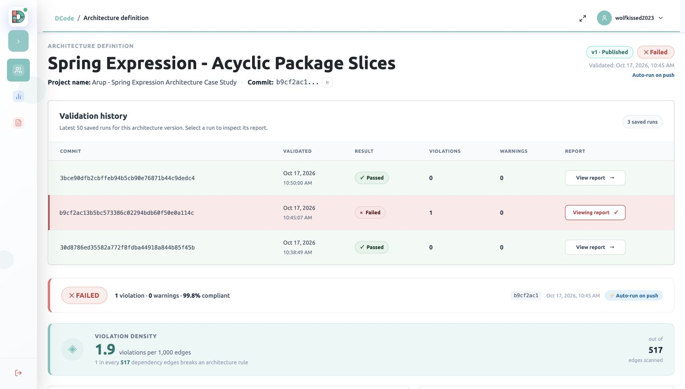
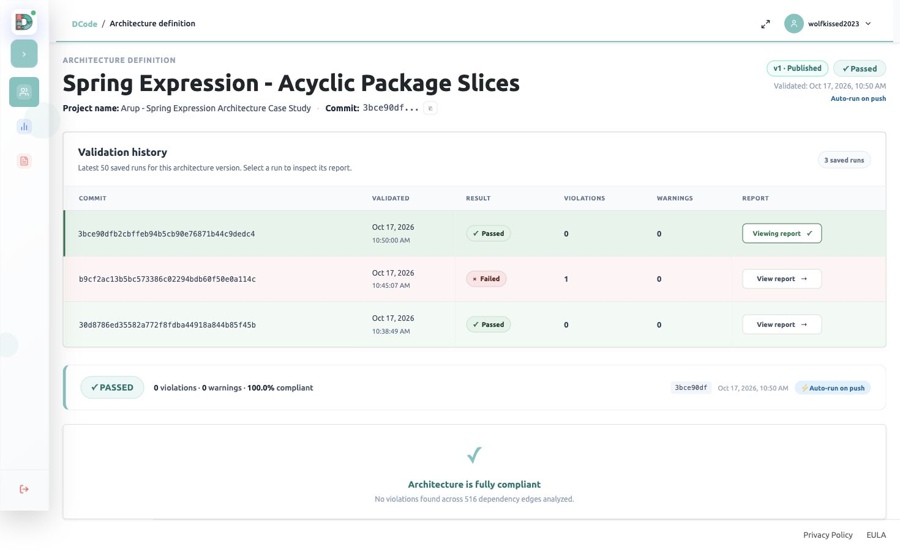

# Spring Expression: case study details

**Can a functionally correct change violate a fixed architecture rule?** In this controlled
case study, adding `ExpressionUtils.evaluate(String)` creates one Common-to-SpEL dependency.
All functional tests pass, but DCode's architecture gate changes from **Passed → Failed**.
Removing the method and its three tests restores the baseline graph and a **Passed** result.

The study covers **`spring-expression/src/main/java`**, one Spring Framework module.
It demonstrates the response to one deliberate mutation under one fixed rule set; it does
not measure general detection accuracy or whole-framework compliance.

Start with the results below, then inspect the [architecture figure](#intended-architecture-and-its-sources),
[controlled change](#controlled-change), and [saved reports](#saved-validation-evidence).
The [preserved evidence bundle](paper-materials/evidence/) supports an offline audit without
DCode membership. [Download the PDF review copy](Spring-Expression-Case-Study.pdf).
For a fresh execution, see [reproduction](#reproduction-workflow).

## Selected revision and experiment commits

The **selected upstream source revision** is
[`49adc91c7e41eaafb52fc11e1210989894bda1f3`](https://github.com/spring-projects/spring-framework/commit/49adc91c7e41eaafb52fc11e1210989894bda1f3).
[Browse the selected module at this revision](https://github.com/spring-projects/spring-framework/tree/49adc91c7e41eaafb52fc11e1210989894bda1f3/spring-expression).

The **baseline analyzed in the fork** is a later commit that includes the CI setup:
[`30d8786ed35582a772f8fdba44918a844b85f45b`](https://github.com/beaprogram/spring-framework/commit/30d8786ed35582a772f8fdba44918a844b85f45b).
These two revisions have different purposes and should not be used interchangeably.
The source repository is [Spring Framework](https://github.com/spring-projects/spring-framework);
the experimental fork is [beaprogram/spring-framework](https://github.com/beaprogram/spring-framework/tree/case-study/spring-expression-architecture).

| Stage | Fork commit | Functional tests passed | Skipped | Dependency edges | DCode result | Violations | CI evidence |
| --- | --- | ---: | ---: | ---: | --- | ---: | --- |
| Baseline | [`30d8786e`](https://github.com/beaprogram/spring-framework/commit/30d8786ed35582a772f8fdba44918a844b85f45b) | 1,074 | 11 | 516 | Passed | 0 | [Run](https://github.com/beaprogram/spring-framework/actions/runs/39037227075) |
| Controlled violation | [`b9cf2ac1`](https://github.com/beaprogram/spring-framework/commit/b9cf2ac13b5bc573386c02294bdb60f50e0a114c) | 1,077 | 11 | 517 | Failed | 1 | [Run](https://github.com/beaprogram/spring-framework/actions/runs/39037674985) |
| Repair | [`3bce90df`](https://github.com/beaprogram/spring-framework/commit/3bce90dfb2cbffeb94b5cb90e76871b44c9dedc4) | 1,074 | 11 | 516 | Passed | 0 | [Run](https://github.com/beaprogram/spring-framework/actions/runs/39038043397) |

Functional tests reported zero failures and errors in all three stages.
All stages used the same 144 graph nodes and published DCode architecture version 1.
Repair removes the added convenience method and its three tests; it restores the
original source dependency edge set rather than preserving the added API.
Spring's independent architecture check also rejected the controlled violation.

## Repository-selection query

- [Exact saved GraphQL query](paper-materials/selection/search.graphql)
- [Query variables](paper-materials/selection/search-variables.json)
- [Original 20-candidate shortlist](paper-materials/selection/candidate-list.csv)
- [Historical search metadata](paper-materials/selection/search-metadata.json)

Submit the query and variables to GitHub's authenticated GraphQL endpoint,
`https://api.github.com/graphql`. Supply a token privately; no credentials are stored here.
Re-running now can return different counts, rankings, and revisions.
The variables file expresses the inputs recorded in the preserved search metadata.

The search required Java repositories with **more than 5,000 stars** and
**at least 1,000 forks**, excluding forks and archived repositories. It narrowed the
popularity-qualified pool using `architecture in:readme`, sorted by descending stars,
and retrieved the first 20 candidates. The historical search recorded 500 repositories
before the README filter and 77 afterward. Spring Framework ranked third, with
60,293 stars and 38,752 forks in that shortlist snapshot.

README keyword matching was a discovery filter, not proof of an architecture.
Candidates were screened in returned order: the first was a collection of examples;
the second used architecture in a CPU/platform context. Spring was the first suitable
framework candidate, and its package constraints and buildable module were then verified.
This is a popularity-ordered selection, not a random sample or an exhaustive ranking
of all 20 repositories by quality.

## Intended architecture and its sources

Spring's maintainer-authored
[`ArchitectureRules.java`](https://github.com/spring-projects/spring-framework/blob/49adc91c7e41eaafb52fc11e1210989894bda1f3/buildSrc/src/main/java/org/springframework/build/architecture/ArchitectureRules.java)
groups packages by their first four segments and prohibits cycles between the slices.
[`ExpressionUtils.java`](https://github.com/spring-projects/spring-framework/blob/49adc91c7e41eaafb52fc11e1210989894bda1f3/spring-expression/src/main/java/org/springframework/expression/common/ExpressionUtils.java)
describes common utilities usable by expression-language providers. The
[framework overview](https://github.com/spring-projects/spring-framework/blob/49adc91c7e41eaafb52fc11e1210989894bda1f3/framework-docs/modules/ROOT/pages/overview.adoc)
provides the broader module context.

The **Expression API** supplies shared parsing and evaluation contracts, including
[`ExpressionParser`](https://github.com/spring-projects/spring-framework/blob/49adc91c7e41eaafb52fc11e1210989894bda1f3/spring-expression/src/main/java/org/springframework/expression/ExpressionParser.java) and
[`Expression`](https://github.com/spring-projects/spring-framework/blob/49adc91c7e41eaafb52fc11e1210989894bda1f3/spring-expression/src/main/java/org/springframework/expression/Expression.java). **Common utilities** provides shared conversion
and template-parsing facilities. **SpEL implementation** contains the concrete
Spring Expression Language parser and evaluation machinery, represented here by
[`SpelExpressionParser`](https://github.com/spring-projects/spring-framework/blob/49adc91c7e41eaafb52fc11e1210989894bda1f3/spring-expression/src/main/java/org/springframework/expression/spel/standard/SpelExpressionParser.java)
and `SpelExpression`.

The same package grouping maps this module's source graph to:

| Component | Package mapping | Type/nested-type graph nodes |
| --- | --- | ---: |
| Expression API | `org.springframework.expression` | 24 |
| Common utilities | `org.springframework.expression.common` | 5 |
| SpEL implementation | `org.springframework.expression.spel` and descendants | 115 |

Existing SpEL-to-Common dependencies make a reverse Common-to-SpEL edge a controlled
way to introduce a cycle. In DCode, **Common utilities to SpEL implementation is Denied**.
That directional rule is our operational interpretation of Spring's acyclic-slice
constraint for this experiment. It is not a literal directional rule quoted from the
maintainers, nor evidence that DCode implements every upstream ArchUnit constraint.
The figure separates the component rule from selected actual source dependencies.
For example, `ExpressionUtils → TypeConverter` connects Common to the Expression API.
Unshown dependencies still exist; this is a focused explanation, not the full graph.



*Reconstruction from preserved published-v1 membership and original analyzer GraphML,
not a DCode screenshot. All five Common members are shown; API and SpEL omissions are
counted. The dashed red arrow denies the component direction. The separate solid red
edge is the mutation; solid blue edges existed in baseline and remain after repair.
[Full membership](paper-materials/component-membership.json) and
[original graphs with an offline verifier](paper-materials/evidence/) allow inspection
of all 144 fully qualified nodes and the depicted edges.*

### What the five Common members contribute

These classes provide shared expression and template facilities. Their responsibilities
explain why Common is a meaningful component, rather than just a box containing five
names. The source links below refer to the selected upstream revision; the added
`evaluate(String)` method belongs only to the controlled violation.

| Common member | Responsibility relevant to the architecture |
| --- | --- |
| [`CompositeStringExpression`](https://github.com/spring-projects/spring-framework/blob/49adc91c7e41eaafb52fc11e1210989894bda1f3/spring-expression/src/main/java/org/springframework/expression/common/CompositeStringExpression.java) | Combines literal text and evaluated expression pieces into a template result. |
| [`ExpressionUtils`](https://github.com/spring-projects/spring-framework/blob/49adc91c7e41eaafb52fc11e1210989894bda1f3/spring-expression/src/main/java/org/springframework/expression/common/ExpressionUtils.java) | Provides shared conversion helpers for expression implementations. The controlled change adds a method that directly constructs a SpEL parser. |
| [`LiteralExpression`](https://github.com/spring-projects/spring-framework/blob/49adc91c7e41eaafb52fc11e1210989894bda1f3/spring-expression/src/main/java/org/springframework/expression/common/LiteralExpression.java) | Represents a fixed string value, including literal portions of a template. |
| [`TemplateAwareExpressionParser`](https://github.com/spring-projects/spring-framework/blob/49adc91c7e41eaafb52fc11e1210989894bda1f3/spring-expression/src/main/java/org/springframework/expression/common/TemplateAwareExpressionParser.java) | Provides a base parser with template support; expression-language parsers supply the expression-specific parsing. |
| [`TemplateParserContext`](https://github.com/spring-projects/spring-framework/blob/49adc91c7e41eaafb52fc11e1210989894bda1f3/spring-expression/src/main/java/org/springframework/expression/common/TemplateParserContext.java) | Supplies template parsing settings, including the expression prefix and suffix. |

The important change is the direction of dependence: `ExpressionUtils` starts depending
on a concrete SpEL parser, while the baseline already contains SpEL-to-Common edges.
The lower part of the figure follows one verified return path; it is not a drawing of
every dependency or a claim that the five Common classes are independent of one another.

The [original published-v1 membership capture](paper-materials/screenshots/published-membership-2026-10-28.jpg)
is retained as supporting UI evidence. Its collapsed canvas is not the explanatory
architecture figure. The detailed reconstruction above combines the preserved membership
with verified source edges. Neither the published definition nor the existing draft was
changed to produce it.

## Controlled change

The [baseline-to-violation source comparison](https://github.com/beaprogram/spring-framework/compare/30d8786ed35582a772f8fdba44918a844b85f45b...b9cf2ac13b5bc573386c02294bdb60f50e0a114c)
adds `ExpressionUtils.evaluate(String)` in Common utilities. It instantiates a typed
`SpelExpressionParser` from SpEL. Three new tests check `6 * 7`, a string uppercase
operation, and a null result. A [preserved diff](paper-materials/evidence/controlled-mutation.diff)
is available alongside the evidence.

The graph comparison has **exactly one added edge and no removed edges**:

```text
ExpressionUtils → SpelExpressionParser       introduced by the controlled mutation
SpelExpressionParser → SpelExpression        already present in the baseline
SpelExpression → ExpressionUtils             already present in the baseline
```

The first edge crosses the denied Common-to-SpEL boundary; the other two form its
return path. This is a deliberate architecture violation, not a naturally occurring
Spring defect. Functional-test success and architecture-gate success answer different
questions, so their disagreement is the intended observation.

The [violation-to-repair comparison](https://github.com/beaprogram/spring-framework/compare/b9cf2ac13b5bc573386c02294bdb60f50e0a114c...3bce90dfb2cbffeb94b5cb90e76871b44c9dedc4)
removes the added method and its three tests. Repair restores the original dependency
edge set; it does **not** preserve the added API through a redesign.

## Saved validation evidence

The following captures were taken on 28 October 2026 by opening the original saved runs
from validation history. The run timestamps remain 17 October. Each image identifies
the selected commit and published architecture version 1. These images replace links
to private project screens: reviewers do not need project membership or a DCode login.

### Baseline — passed


Commit `30d8786e`: 0 violations, 0 warnings, 100% compliance, 516 dependency edges.

### Controlled violation — failed



Commit `b9cf2ac1`: 1 violation, 0 warnings, 517 dependency edges. The report identifies
`ExpressionUtils → SpelExpressionParser` across the denied Common-to-SpEL boundary.
The 99.8% aggregate compliance rate does **not** make the architecture gate pass:
one denied dependency is sufficient for failure.
[Open the full original violation report](paper-materials/screenshots/violation-report-2026-10-28.jpg)
for the **Forbidden Dependencies** and **Rule Breakdown** sections near the bottom.
The clean overview above is a viewport capture; the PDF also includes a labeled lower-report excerpt.

### Repair — passed



Commit `3bce90df`: 0 violations, 0 warnings, 100% compliance, 516 dependency edges.
Removing the controlled mutation restores the original dependency edge set.

## Reproduction workflow

The checked-in [GitHub Actions workflow](../.github/workflows/dcode-spring-expression.yml)
runs the module functional tests, records Spring's upstream module checks, extracts
production-source dependencies with a hash-pinned analyzer, uploads with the actual
commit SHA, and enforces the active DCode architecture gate. Upstream checks are recorded
separately so their failure cannot prevent recording the DCode verdict; their failures
are still enforced before job completion. Artifacts are retained even on gate failure.
A successful upload with an inactive gate is not a passing architecture result.

### Audit the saved result without credentials

The [evidence bundle](paper-materials/evidence/) contains original result JSON, GraphML,
upstream-check logs and repacked original JUnit XML for each stage. Its provenance file
records original artifact names and individual XML hashes. The verifier checks the
checksum manifest, re-counts tests, checks node membership and all three gate results,
and compares edge sets and the illustrated return path.

```sh
python3 case-study/paper-materials/evidence/verify.py
```

Run that command from this repository checkout. Expected output: 1,074 / 1,077 / 1,074
passed tests; 11 skipped per stage; 144 nodes in each graph; 516 / 517 / 516 edges;
PASSED / FAILED / PASSED gates; exactly one introduced edge and exact repair restoration.
This audits preserved evidence; it does not reproduce the analyzer or server execution.

### Repeat the experiment in a separate checkout

Use a fresh clone so switching to historical commits does not disturb documentation work:

```sh
git clone https://github.com/beaprogram/spring-framework.git spring-expression-reproduction
cd spring-expression-reproduction
git checkout --detach 30d8786ed35582a772f8fdba44918a844b85f45b
./gradlew :spring-expression:test --no-daemon --max-workers=2
./gradlew :spring-expression:check --no-daemon --max-workers=2
```

Repeat the checkout and the two Gradle commands for these full revisions:

| Stage | Commit | Expected functional tests | Expected upstream architecture check |
| --- | --- | --- | --- |
| Baseline | `30d8786ed35582a772f8fdba44918a844b85f45b` | 1,074 passed; 11 skipped | Pass |
| Controlled violation | `b9cf2ac13b5bc573386c02294bdb60f50e0a114c` | 1,077 passed; 11 skipped | Fail: package-slice cycle |
| Repair | `3bce90dfb2cbffeb94b5cb90e76871b44c9dedc4` | 1,074 passed; 11 skipped | Pass |

The recorded workflow uses **Temurin JDK 25**, the checked-in Gradle wrapper, and an
Ubuntu GitHub runner (`ubuntu-latest`, which is not an immutable environment).
Inspect the workflow at each recorded commit; dependency downloads require network access.
The analyzer is DesigniteJava with SHA-256
`8324e6d1a5fc706295a3f46d3124c69e458315ebfbe62c1e364f48e2ca45e73b`.
Its download URL is mutable: a changed binary must fail the checksum check, not silently
replace the recorded analyzer. Access to a matching binary and applicable license/trial
capacity is required for fresh graph extraction.

To repeat DCode validation in your own authorized project:

1. Use the recorded workflow and extraction scope `spring-expression/src/main/java`.
2. Configure secret `DCODE_API_KEY` and variables `DCODE_PROJECT_ID` and `DCODE_ENFORCE_ARCH`.
   Never put the API key in source. The original workflow restricts execution to the
   experimental fork; a different fork must adapt that repository guard in its own copy.
3. Bootstrap the graph with enforcement `false` only if needed to define the architecture.
   Recreate the exact [component membership](paper-materials/component-membership.json)
   and denied Common-to-SpEL rule in that project, then publish it.
4. Set enforcement to `true` and keep that published definition fixed for all three stages.
   The original project's definition was v1; a separate project may assign a different
   version number. Match its contents, not just its label.
5. Execute the recorded stages, uploading each actual commit SHA. Inspect `dcode-result.json`
   and confirm `is_active: true`, the expected verdict, violation count and edge count.
   The original workflow does not automatically import the saved membership JSON.

## Limits and interpretation

This is one module, one fixed rule set and one deliberately introduced source change.
It does not establish whole-framework compliance, runtime dependency coverage, or
accuracy on naturally occurring defects. A passing gate means the configured rules
passed for that extracted graph, not that all architectural properties were checked.

Other Spring modules are build dependencies only. The graph covers Java production
sources, not external libraries, runtime edges, Kotlin sources or test classes. Graph
nodes, source files, analyzer type rows and dashboard class counts must not be equated.

A fresh hosted run depends on the available analyzer, service version, credentials,
runner and dependencies. These are not all immutable; identical present-day results
are not guaranteed. The public archived evidence supports auditing the recorded run
without those prerequisites. Checksums establish bundle integrity, not independent
proof of original execution. No analysis was rerun during this documentation revision.
