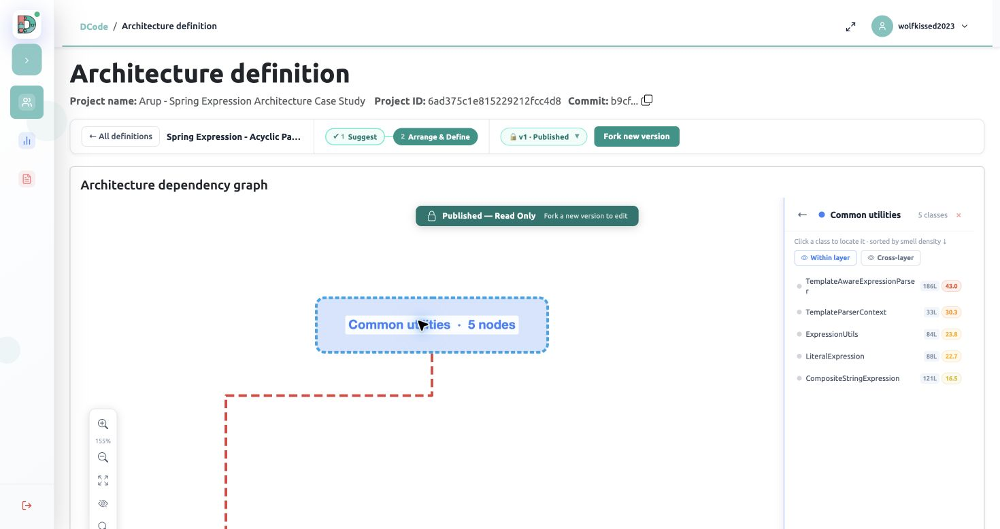
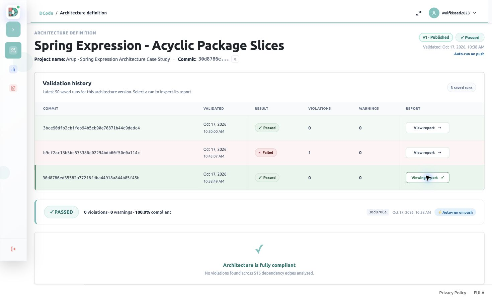
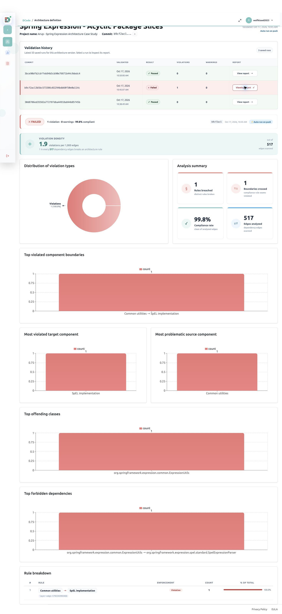
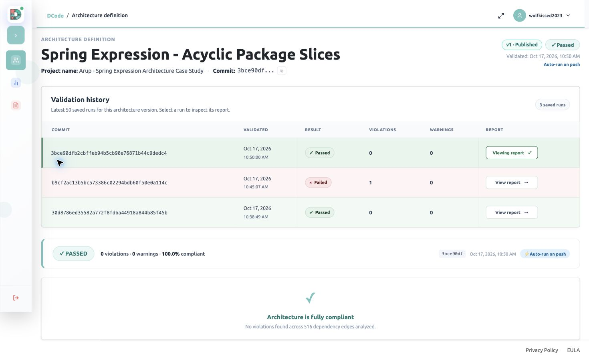

# Spring Expression: case study details

This page brings together the repository selection, architecture definition, controlled
change, saved validation results, and reproduction workflow for the Spring Expression case study.
All figures and explanations below are available without a DCode account.
The experiment studies **`spring-expression/src/main/java`**, not all of Spring Framework.

## Selected revision and experiment commits

The **selected upstream source revision** is
[`49adc91c7e41eaafb52fc11e1210989894bda1f3`](https://github.com/spring-projects/spring-framework/commit/49adc91c7e41eaafb52fc11e1210989894bda1f3).
[Browse the selected module at this revision](https://github.com/spring-projects/spring-framework/tree/49adc91c7e41eaafb52fc11e1210989894bda1f3/spring-expression).

The **baseline analyzed in the fork** is a later commit that includes the CI setup:
[`30d8786ed35582a772f8fdba44918a844b85f45b`](https://github.com/beaprogram/spring-framework/commit/30d8786ed35582a772f8fdba44918a844b85f45b).
These two revisions have different purposes and should not be used interchangeably.
The source repository is [Spring Framework](https://github.com/spring-projects/spring-framework);
the experimental fork is [beaprogram/spring-framework](https://github.com/beaprogram/spring-framework/tree/case-study/spring-expression-architecture).

| Stage | Fork commit | Functional tests passed | Skipped | Dependency edges | DCode result | Violations | CI evidence |
| --- | --- | ---: | ---: | ---: | --- | ---: | --- |
| Baseline | [`30d8786e`](https://github.com/beaprogram/spring-framework/commit/30d8786ed35582a772f8fdba44918a844b85f45b) | 1,074 | 11 | 516 | Passed | 0 | [Run](https://github.com/beaprogram/spring-framework/actions/runs/39037227075) |
| Controlled violation | [`b9cf2ac1`](https://github.com/beaprogram/spring-framework/commit/b9cf2ac13b5bc573386c02294bdb60f50e0a114c) | 1,077 | 11 | 517 | Failed | 1 | [Run](https://github.com/beaprogram/spring-framework/actions/runs/39037674985) |
| Repair | [`3bce90df`](https://github.com/beaprogram/spring-framework/commit/3bce90dfb2cbffeb94b5cb90e76871b44c9dedc4) | 1,074 | 11 | 516 | Passed | 0 | [Run](https://github.com/beaprogram/spring-framework/actions/runs/39038043397) |

Functional tests reported zero failures and errors in all three stages.
All stages used the same 144 graph nodes and published DCode architecture version 1.
Repair removes the added convenience method and its three tests; it restores the
original source dependency edge set rather than preserving the added API.
Spring's independent architecture check also rejected the controlled violation.

## Repository-selection query

- [Exact saved GraphQL query](paper-materials/selection/search.graphql)
- [Query variables](paper-materials/selection/search-variables.json)
- [Original 20-candidate shortlist](paper-materials/selection/candidate-list.csv)
- [Historical search metadata](paper-materials/selection/search-metadata.json)

Submit the query and variables to GitHub's authenticated GraphQL endpoint,
`https://api.github.com/graphql`. Supply a token privately; no credentials are stored here.
Re-running now can return different counts, rankings, and revisions.
The variables file expresses the inputs recorded in the preserved search metadata.

The search required Java repositories with **more than 5,000 stars** and
**at least 1,000 forks**, excluding forks and archived repositories. It narrowed the
popularity-qualified pool using `architecture in:readme`, sorted by descending stars,
and retrieved the first 20 candidates. The historical search recorded 500 repositories
before the README filter and 77 afterward. Spring Framework ranked third, with
60,293 stars and 38,752 forks in that shortlist snapshot.

README keyword matching was a discovery filter, not proof of an architecture.
Candidates were screened in returned order: the first was a collection of examples;
the second used architecture in a CPU/platform context. Spring was the first suitable
framework candidate, and its package constraints and buildable module were then verified.
This is a popularity-ordered selection, not a random sample or an exhaustive ranking
of all 20 repositories by quality.

## Intended architecture and its sources

Spring's maintainer-authored
[`ArchitectureRules.java`](https://github.com/spring-projects/spring-framework/blob/49adc91c7e41eaafb52fc11e1210989894bda1f3/buildSrc/src/main/java/org/springframework/build/architecture/ArchitectureRules.java)
groups packages by their first four segments and prohibits cycles between the slices.
[`ExpressionUtils.java`](https://github.com/spring-projects/spring-framework/blob/49adc91c7e41eaafb52fc11e1210989894bda1f3/spring-expression/src/main/java/org/springframework/expression/common/ExpressionUtils.java)
describes common utilities usable by expression-language providers. The
[framework overview](https://github.com/spring-projects/spring-framework/blob/49adc91c7e41eaafb52fc11e1210989894bda1f3/framework-docs/modules/ROOT/pages/overview.adoc)
provides the broader module context.

The same package grouping maps this module's source graph to:

| Component | Package mapping | Type/nested-type graph nodes |
| --- | --- | ---: |
| Expression API | `org.springframework.expression` | 24 |
| Common utilities | `org.springframework.expression.common` | 5 |
| SpEL implementation | `org.springframework.expression.spel` and descendants | 115 |

Existing SpEL-to-Common dependencies make a reverse Common-to-SpEL edge a controlled
way to introduce a cycle. In DCode, **Common utilities to SpEL implementation is Denied**.
That directional rule is our operational interpretation of Spring's acyclic-slice
constraint for this experiment. It is not a literal directional rule quoted from the
maintainers, nor evidence that DCode implements every upstream ArchUnit constraint.
The Expression API component is included even though the screenshot's explicit red
rule connects only Common and SpEL; absence of another drawn rule does not mean the
corresponding source dependencies are absent.

*Detailed reconstruction from the preserved architecture membership: all five Common
utilities nodes are shown, together with representative API and SpEL nodes. The dashed
red arrow is the component-level **Denied** rule, not a source dependency. Omitted nodes
are counted explicitly. [Full membership of all 144 nodes](paper-materials/component-membership.json)
is supplied for inspection. The figure does not imply that unshown dependencies are absent.*

Original DCode evidence for the published rule and Common membership

The published definition is read-only. This capture shows the original component and
the complete Common member list; the more detailed figure above makes those members
visible together with the surrounding architecture. Opening a saved report or changing
the view did not rerun analysis or publish another architecture version.

## Saved validation evidence

The following captures were taken on 27 October 2026 by opening the original saved runs
from validation history. The run timestamps remain 17 October. Each image identifies
the selected commit and published architecture version 1. These images replace links
to private project screens: reviewers do not need project membership or a DCode login.

### Baseline — passed

Commit `30d8786e`: 0 violations, 0 warnings, 100% compliance, 516 dependency edges.

### Controlled violation — failed

Commit `b9cf2ac1`: 1 violation, 0 warnings, 517 dependency edges. The report identifies
`ExpressionUtils → SpelExpressionParser` across the denied Common-to-SpEL boundary.
The 99.8% aggregate compliance rate does **not** make the architecture gate pass:
one denied dependency is sufficient for failure.

### Repair — passed

Commit `3bce90df`: 0 violations, 0 warnings, 100% compliance, 516 dependency edges.
Removing the controlled mutation restores the original dependency edge set.

## Reproduction workflow

The checked-in [GitHub Actions workflow](../.github/workflows/dcode-spring-expression.yml)
runs the module functional tests, records Spring's upstream module checks, extracts
production-source dependencies with a hash-pinned analyzer, uploads with the actual
commit SHA, and enforces the active DCode architecture gate. Upstream checks are recorded
separately so their failure cannot prevent recording the DCode verdict; their failures
are still enforced before job completion. Artifacts are retained even on gate failure.
A successful upload with an inactive gate is not a passing architecture result.

1. Check out the desired experiment commit from the results table.
2. Inspect the workflow at that commit for the Java version and pinned analyzer checksum.
3. Run the functional tests with `./gradlew :spring-expression:test --no-daemon --max-workers=2`.
4. Run the independent upstream module checks with `./gradlew :spring-expression:check --no-daemon --max-workers=2`.
5. To reproduce DCode validation in your own authorized project, configure the workflow
   secret `DCODE_API_KEY` and variables `DCODE_PROJECT_ID` and `DCODE_ENFORCE_ARCH`.
   Keep the same three component memberships and denied Common-to-SpEL rule for all stages.
   Set enforcement to `true` for final validation; `false` is only for initial bootstrap.
6. Compare the saved CI artifacts and gate verdicts with the table above. Never put
   API keys in source or paste them into issue reports.

Other Spring modules are build dependencies only. The graph covers Java production
sources, not external libraries, runtime edges, Kotlin sources, or test classes. The
analyzer trial limit is a further constraint on reproducing the original extraction.

## Controlled change and limits

The mutation adds `ExpressionUtils.evaluate(String)`, which instantiates a typed
`SpelExpressionParser`. Three additional functional tests cover arithmetic, a string
operation, and a null result. The new source dependency is
`ExpressionUtils` to `SpelExpressionParser`. With the existing return path through
`SpelExpression`, this closes a package-slice cycle. Functional behavior continues to
pass while architectural compliance fails; removing the mutation restores compliance.

These results cover one module, one fixed rule set, and one deliberate source-code
change. They do not establish whole-framework compliance, runtime dependency coverage,
or detection accuracy on naturally occurring defects. Graph nodes, source files, and
dashboard class counts measure different things and must not be equated.
